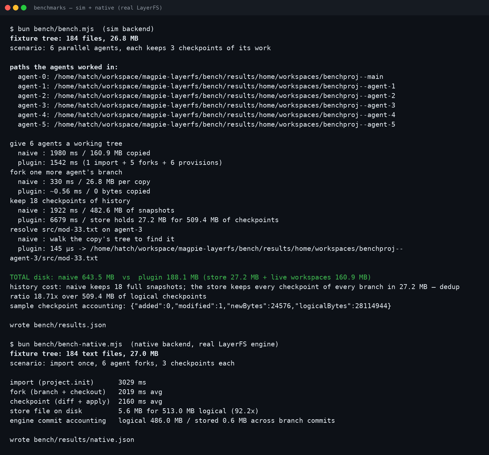

# LayerFS for Magpie

[LayerFS](https://github.com/Ephemeral-AI-Lab/layerfs) workspaces for every
agent [magpie](https://usemagpie.ai) connects: instead of each agent copying
a project tree to work on it, agents share one durable, deduplicated history
and work through **stable filesystem paths**. Forking a branch for a
parallel agent copies **no file bytes**; a checkpoint stores **only what
changed**; any agent can resolve, read and build on what the others
committed.

给每个 agent 的 LayerFS 工作区：多个 agent 共享一份可去重的持久历史，而不是
各自复制整棵项目树。给并行 agent 开分支不复制任何文件字节；存检查点只写
变化的部分；路径稳定，任何 agent 都能定位、读取并接续其他 agent 的提交。

```sh
magpie plugin add @magpie-community/tools-layerfs
magpie plugin            # lists layerfs_provision, layerfs_checkpoint, ...
```

## Tools

Served on magpie's MCP server as `layerfs_<tool>`:

| Tool | What it does |
|---|---|
| `provision` | Gives the agent a workspace for a project branch and answers the path to work in. The first provision imports the source directory as the project's first checkpoint; later provisions of the same branch answer the same path without copying the tree again. |
| `checkpoint` | Saves the workspace's state on its branch, storing only the blobs the store has not seen; answers added / modified / deleted counts and the new-bytes vs saved-bytes accounting. |
| `fork` | Forks a branch for a parallel agent: a pointer at an existing checkpoint, ready immediately, 0 bytes copied. |
| `history` | Lists a branch's checkpoints, newest first, with each one's logical tree size and the bytes it actually stored. |
| `resolve` | Resolves a project / branch / file to a real filesystem path, its checkpoint and content hash — an O(1) lookup, no copying. |
| `status` | Backend in use, projects and branches held, and the storage accounting: logical bytes of all checkpoints vs bytes the store occupies. |

## Backends

- **native** — the real LayerFS through its JavaScript SDK
  (`@layerfs/sdk` from a [layerfs](https://github.com/Ephemeral-AI-Lab/layerfs)
  checkout; the SDK is not on npm). Set `LAYERFS_SDK_PATH` (the SDK entry,
  `sdk/js/src/index.js`) and `LAYERFS_STORE_PATH` (the store file on the
  mounted LayerFS volume), and the plugin mounts real LayerFS workspaces:
  copy-on-write paths served by the LayerFS daemons, with the engine's own
  chunk-level dedup.
- **sim** (default when the SDK is not configured) — a local
  content-addressed store implementing the same model: immutable blobs
  named by SHA-256, branches as manifest pointers, checkpoints as
  deduplicated manifests, under `MAGPIE_LAYERFS_HOME`
  (default `~/.magpie-layerfs`). It runs anywhere, which is what the tests
  and the benchmark below use.

`MAGPIE_LAYERFS_BACKEND=auto|native|sim` selects explicitly; `auto` picks
native when both SDK variables are set.

## Benchmark

`bun bench/bench.mjs` — a 184-file, 26.8 MB project; 6 parallel agents,
each keeping 3 checkpoints (sim backend, this machine):

| | naive copies | this plugin |
|---|---|---|
| fork one more agent | 321 ms, 26.8 MB copied | **~1 ms, 0 bytes** |
| keep 18 checkpoints | 482.6 MB of snapshots | **27.2 MB** of store for 509.4 MB of logical checkpoints (**18.7× dedup**) |
| resolve a file path | walk the copy's tree | **138 µs**, with its checkpoint + SHA-256 |
| total disk for the run | 643.5 MB | **188.1 MB** (store + the 6 live workspaces) |




Honest limits: a first provision still materializes the tree once, and the
sim backend rehashes the tree at each checkpoint (the native engine tracks
changes through its daemons instead). What the plugin removes is the
per-agent copy, the per-snapshot copy, and the bytes they waste — the
engine's own benchmarks are at
[layerfs.ai/benchmarks](https://layerfs.ai/benchmarks/).

## Develop

```sh
bun test                 # the suite (bun:test), sim backend end to end
bun bench/bench.mjs      # the benchmark above; writes bench/results.json
```

Zero runtime dependencies; the arguments are JSON Schema, like the other
tools packages. MIT.
